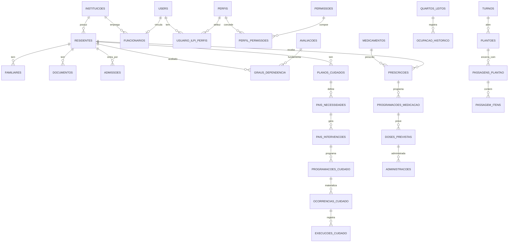
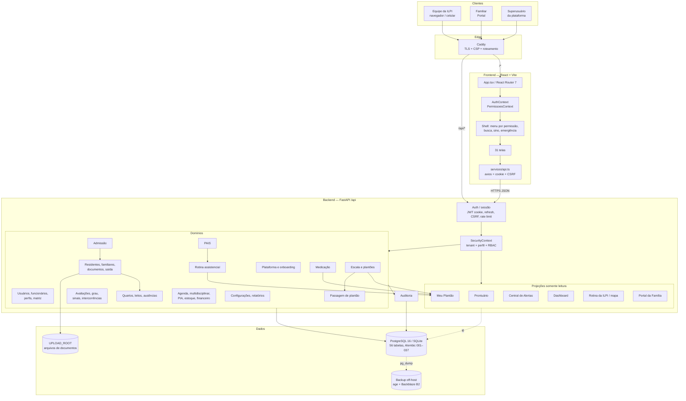
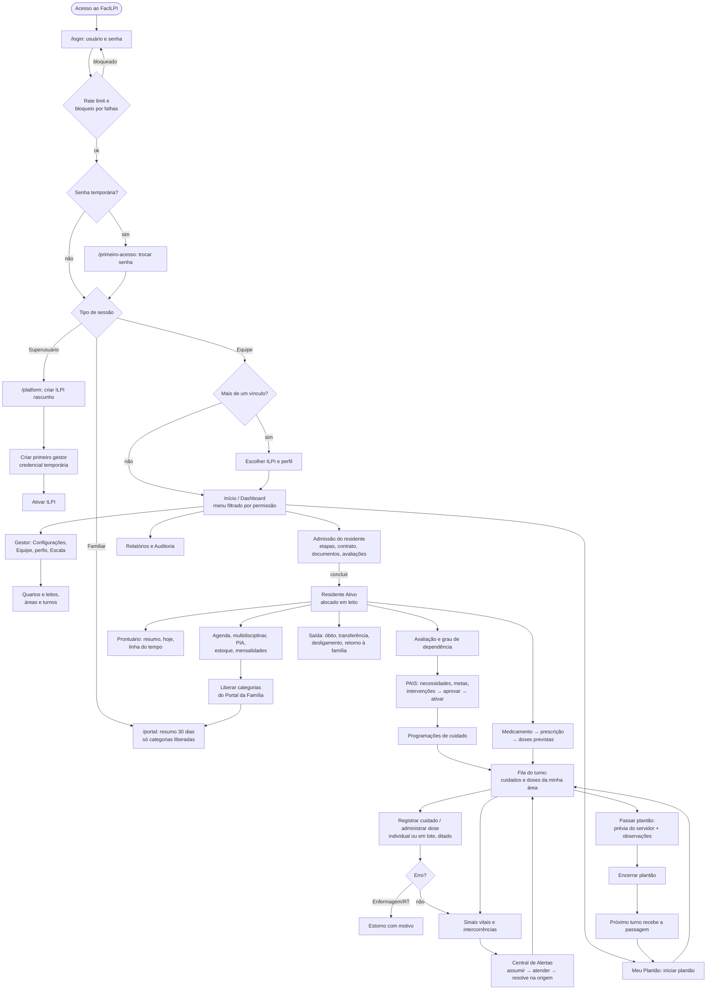

# Estado Atual do Projeto — FacILPI

> Relatório técnico gerado a partir do **código** da `main` em `b6a0c57` (Merge do PR #306), lido em 23/11/2026.
> Fonte: código-fonte, migrations, rotas, modelos, componentes e configuração versionados. Documentos históricos (`Project.md`, `Prompt.txt`, `README.md`, `config/*.md`) **não** foram usados como fonte de funcionalidade.
> É um retrato: o estado oficial continua sendo o GitHub (Issues, PRs, CI).

---

## 1. Árvore de diretórios e arquitetura

### 1.1 Estrutura (469 arquivos versionados)

```text
FacILPI/
├── .claude/                 # Regras, skills e hooks do agente (governança de desenvolvimento)
│   ├── rules/               #   backend-security, frontend, testing
│   ├── skills/              #   plan-issue, implement-issue, review-pr, security-review, ...
│   └── hooks/               #   block-env-files.sh (bloqueia leitura de .env)
├── .github/workflows/ci.yml # CI: frontend, backend-sqlite, backend-postgres, e2e
├── backend/
│   ├── alembic/versions/    # 37 migrations (001_initial → 037_portal_familia_config)
│   ├── src/
│   │   ├── main.py          # App FastAPI, CORS, auth básica, CRUD genérico, rotas clínicas legadas, registro de routers
│   │   ├── application/     # 28 módulos: routers + regras de negócio por domínio
│   │   ├── domain/          # validators.py (validações de domínio puras)
│   │   ├── infrastructure/  # models.py (ORM), database.py (engine), db_guard.py (proteção do banco oficial)
│   │   └── scripts/         # bootstrap.py (criação do primeiro superusuário)
│   ├── tests/               # ~100 arquivos pytest (852 funções de teste) + seeds E2E e guards
│   └── requirements*.txt, constraints.txt, alembic.ini
├── frontend/
│   ├── src/
│   │   ├── App.tsx          # Roteamento (React Router 7)
│   │   ├── pages/           # 32 telas
│   │   ├── components/      # shell, plantao, prontuario, equipe, documentos, platform, ui (shadcn-like) ...
│   │   ├── context/         # AuthContext, PermissoesContext
│   │   ├── hooks/           # useCentralAlertas, useEquipe, useFiltrosUrl, useGrausAtivos ...
│   │   ├── services/        # 22 clientes de API (axios)
│   │   ├── lib/ types/      # utilitários, rótulos, aparência (tema), tipos
│   │   └── __tests__/       # ~75 arquivos Vitest + Testing Library
│   ├── e2e/                 # Playwright: fluxo crítico, cross-tenant, dashboard, portal, complementares
│   └── vite.config.ts, playwright.config.ts, eslint.config.js
├── docker/                  # Dockerfile.backend, Dockerfile.frontend, Caddyfile (edge)
├── docker-compose.yml       # edge (Caddy) + backend + frontend + db (Postgres 16)
├── ops/                     # backup/restore, off-host (B2/age), drill de restauração, retenção
├── docs/                    # ARCHITECTURE, DOMAIN_RULES, GOVERNANCE, STATUS, ROADMAP, RUNBOOKs
├── storage/                 # Dados de runtime locais (banco SQLite oficial — protegido contra testes)
└── config/, Project.md, Prompt.txt, README.md   # Referências históricas da fase inicial
```

### 1.2 Camadas e responsabilidades

| Camada | Local | Responsabilidade | Tecnologias |
|---|---|---|---|
| **Edge / proxy** | `docker/Caddyfile` | TLS, cabeçalhos de segurança (CSP etc.), `/api/*` → backend:8000, resto → frontend:8080 | Caddy 2.8 |
| **Frontend** | `frontend/` | SPA mobile-first; cliente da API, sem autoridade de regra. Esconde itens de menu conforme permissões da sessão | React 18, TypeScript 5.7, Vite 6, Tailwind 4, Radix UI, lucide-react, axios, React Router 7 |
| **API / aplicação** | `backend/src/main.py`, `application/` | Rotas REST sob `/api`, regras de negócio, RBAC, tenant, autoria, auditoria | FastAPI ≥0.115, Pydantic 2, Uvicorn |
| **Segurança** | `application/security.py`, `auth.py`, `runtime.py` | `SecurityContext` (usuário + ILPI + perfil + permissões), JWT, cookies HttpOnly, CSRF, rate limit, CORS por ambiente | PyJWT (HS256), bcrypt |
| **Domínio** | `domain/validators.py` | Validações puras | Python |
| **Persistência** | `infrastructure/` | 56 modelos ORM, `UtcDateTime` (UTC sempre), engine assíncrona, guard do banco oficial | SQLAlchemy 2 async, aiosqlite, asyncpg |
| **Banco** | `alembic/versions/` | Schema versionado (Alembic é a única fonte; `create_all` só com `ALLOW_CREATE_ALL=true` em teste) | SQLite (local/testes), PostgreSQL 16 (piloto/CI) |
| **Operação** | `ops/` | `pg_dump` → criptografia `age` → Backblaze B2 (Object Lock), verificação e restore | Bash, Docker |
| **Qualidade** | `.github/workflows/ci.yml` | Lint/testes frontend, pytest em SQLite e PostgreSQL, E2E Playwright | GitHub Actions |

**Integrações externas implementadas:** nenhuma integração de negócio (sem e-mail, SMS, gateway de pagamento, prontuário externo ou IA). As únicas dependências externas são operacionais (Backblaze B2 para backup off-host). O ditado por voz (`components/plantao/Ditado.tsx`) usa a API de reconhecimento de fala do próprio navegador.

### 1.3 Princípios arquiteturais observados no código

- **Multi-tenant**: quase toda tabela tem `ilpi_id` → `instituicoes`; FKs compostas `(ilpi_id, id)` garantem que pai e filho estejam na mesma ILPI. `ensure_same_tenant` e a resposta `RESOURCE_NOT_FOUND` (404) evitam revelar existência cross-tenant.
- **Tenant e autoria da sessão**: `require_ilpi_context` deriva a ILPI do token; colunas `*_por`/`autor_id` são preenchidas pela identidade autenticada (migration 029).
- **Histórico sem apagar**: correções via estorno (`/estornar`), substituição, nova versão, revogação ou encerramento.
- **Projeções, não novas fontes**: Prontuário, Meu Plantão, Central de Alertas, Dashboard, Rotina da ILPI e Portal da Família são leituras calculadas sobre as tabelas oficiais.

---

## 2. Inventário de funcionalidades

### 2.1 Frontend — telas e fluxos (`frontend/src/App.tsx`)

**Acesso e plataforma**

| Rota | Tela | O que faz |
|---|---|---|
| `/login` | `Login` | Login por usuário/senha; sessão em cookie HttpOnly + CSRF |
| `/primeiro-acesso` | `PrimeiroAcesso` | Troca obrigatória da senha temporária |
| `/platform/instituicoes`, `/nova`, `/:id` | `PlatformInstituicoes*` | Superusuário da plataforma: cria, edita, ativa/inativa ILPI, cria primeiro gestor com credencial temporária |
| (componente) | `ContextPicker` / `ContextSwitcher` | Escolha de ILPI + perfil quando o usuário tem mais de um vínculo |
| `/portal` | `PortalFamilia` | Portal do familiar: resumo dos últimos 30 dias (remédios, alimentação, atividades, peso, recados, agenda, mensalidades) conforme categorias liberadas pela ILPI |

**Operação do turno**

| Rota | Tela | O que faz |
|---|---|---|
| `/` | `Dashboard` | Início: métricas, alertas, gráficos de pendências das próximas 12 h e intercorrências por semana |
| `/plantao` | `MeuPlantao` | Iniciar/encerrar plantão, minha área, fila de cuidados e doses (visões por horário/cuidado/residente), registro rápido e em lote, ditado por voz, cuidado em outro horário (≤24 h), aba Feitos/Expirados, correção por estorno (Enfermagem/RT), "Passar plantão" |
| `/rotina` | `RotinaIlpi` | Mapa da rotina do turno (manhã/tarde/noite no fuso da ILPI) de todos os residentes |
| `/passagem` | `PassagemPlantao` | Prévia montada pelo servidor, observações e recebimento da passagem |
| `/alertas` | `Alertas` | Central de Alertas: assumir, atender, liberar; histórico e expirados. Sino no cabeçalho (`SinoAlertas`) |
| `/escala` | `Escala` | Áreas operacionais, leitos por área, turnos, escala planejada (ausência, substituição, cancelamento), responsáveis agora |

**Residentes e cuidado**

| Rota | Tela | O que faz |
|---|---|---|
| `/residentes` | `Residentes` | Lista, cadastro, registrar saída (óbito, transferência, desligamento, retorno à família) |
| `/residentes/:id` | `ResidenteProntuario` | Cabeçalho, aba Resumo (inclui familiares), painel "Hoje", monitoramento de sinais, linha do tempo longitudinal com filtros e paginação |
| `/residentes/:id/medicacao`, `/medicacao` | `Medicacao` | Medicamentos, prescrições (ativar, suspender, encerrar, substituir, reconciliar) e grade de doses |
| `/admissoes`, `/admissoes/:id` | `Admissoes`, `AdmissaoDetalhe` | Fluxo de admissão por etapas com pendências, responsável, contrato, requisitos de avaliação, reabrir/cancelar/desistir |
| `/avaliacoes` | `Avaliacoes` | Avaliações e grau de dependência (com confirmação humana) |
| `/plano`, `/plano/:id` | `Pais`, `PaisDetalhe` | PAIS: plano, necessidades, metas, intervenções; revisar, aprovar, ativar, nova versão, encerrar |
| `/cuidados` | `Cuidados` | Programações de cuidado (criar/editar/cancelar) |
| `/sinais` | `SinaisVitais` | Registro e histórico de aferições |
| `/intercorrencias` | `Intercorrencias` | Registro, acompanhamento e encerramento |
| `/documentos` | `Documentos` | Cadastro, anexo de arquivo e validação de documentos |
| `/quartos` | `QuartosLeitos` | Leitos, alocação, liberação, transferência, ausências e histórico de ocupação |
| `/agenda` | `Agenda` | Eventos/consultas dos residentes (concluir/cancelar) |
| `/multidisciplinar/:area` | `Multidisciplinar` | Atendimentos por área: fisioterapia, nutrição, psicologia, serviço social, enfermagem (com estorno) |
| `/pia` | `Pia` | Plano Individual de Atendimento versionado por residente |

**Gestão e instituição**

| Rota | Tela | O que faz |
|---|---|---|
| `/equipe` | `Equipe` | Funcionários, usuários, conceder/revogar acesso, vincular usuário, perfis e permissões, inativar |
| `/estoque` | `Estoque` | Itens, saldo por lote/validade, movimentos |
| `/financeiro` | `Financeiro` | Mensalidades manuais (lançar, pagar, cancelar) |
| `/relatorios` | `Relatorios` | Resumo do período (residentes, intercorrências, medicação) |
| `/auditoria` | `Auditoria` | Consulta da trilha "quem fez o quê e quando" |
| `/configuracoes` | `Configuracoes` | Dados da ILPI, contato, licença, fuso; configuração do Portal da Família |
| `/modulos/:modulo` | `ModuleHub` | Hub de cada grupo do menu (cards dos itens visíveis) |

**Recursos transversais de UI:** busca global, botão de Emergência, diálogo de Aparência (tema claro/escuro com tokens testados para contraste), aviso de transição clínica do `ilpi_admin`, menu lateral filtrado por permissão (`components/shell/navegacao.ts`).

### 2.2 Backend — endpoints e regras (`/api/...`)

| Domínio | Prefixos | Endpoints e regras principais | Arquivo |
|---|---|---|---|
| Saúde | `/health` | Healthcheck | `main.py` |
| Autenticação | `/auth` | `POST /token` (login com rate limit e bloqueio após 10 falhas/15 min), `PUT /password`, `POST /refresh` (rotação por família de refresh token), `POST /logout`, `PUT /primeiro-acesso`, `GET /permissoes`, `POST /contexto` (troca ILPI/perfil). `/register` devolve **410** (desativado) | `main.py`, `fase3a.py`, `auth.py` |
| Bootstrap/onboarding | `/bootstrap`, `/onboarding` | Estado de bootstrap; iniciar ILPI e definir admin atual | `fase3a.py`, `bootstrap_state.py` |
| Plataforma | `/platform/instituicoes`, `/instituicoes` | CRUD de ILPI, ativar/inativar, primeiro gestor com credencial temporária; relatório de transição clínica | `platform.py`, `fase3a.py`, `transicao_clinica.py` |
| Usuários e equipe | `/usuarios`, `/funcionarios`, `/perfis`, `/permissoes`, `/matriz` | Usuários, reset de senha (exige vínculo ativo na ILPI da sessão), funcionários, vínculo funcionário↔usuário, perfis e permissões, matriz de atribuição/revogação | `fase3a.py`, `matriz.py` |
| Residentes | `/residentes`, `/residentes/{id}/saida`, `/residentes/{id}/prontuario` | CRUD genérico (situação só muda pela Admissão/saída); saída com pendências e estorno; prontuário como projeção paginada por cursor, com `autor_nome` | `main.py`, `saida_residente.py`, `prontuario.py` |
| Familiares e portal | `/familiares`, `/portal` | CRUD de familiares; liberar acesso do familiar ao portal, recados, configuração por ILPI (tudo começa bloqueado), resumo para o familiar (acesso auditado) | `main.py`, `portal_familia.py` |
| Documentos | `/documentos` | CRUD, upload/download de arquivo em `UPLOAD_ROOT` separado do banco, validação | `main.py` |
| Quartos/leitos | `/quartos_leitos`, `/ausencias`, `/ocupacao_historico` | Leitos, alocar, liberar, transferir, inativar; ausências (abrir/encerrar) sem desocupar o leito; histórico append-only | `fase5a2d.py` |
| Admissão | `/admissoes` | Máquina de etapas: avançar, concluir (ativa o residente), reabrir, cancelar, desistir, responsável, contrato, requisitos de avaliação, pendências e histórico | `admissoes.py` |
| Avaliações e grau | `/avaliacoes`, `/graus-dependencia` | Avaliações; grau com histórico, `ativo` e revogação (fonte oficial do grau) | `main.py` |
| Sinais vitais | `/sinais-vitais` | Registro e consulta | `main.py` |
| Intercorrências | `/intercorrencias` | Registrar, editar, encerrar; `ocorrido_em` | `main.py` |
| PAIS | `/planos-cuidados` | Plano versionado (revisar → aprovar → ativar → nova versão → encerrar), necessidades, metas, intervenções | `pais.py` |
| Rotina assistencial | `/programacoes-cuidado`, `/ocorrencias-cuidado`, `/execucoes-cuidado`, `/plantao` | Programação → ocorrência → execução; reconciliar, cancelar, estornar; fila do plantão e `GET /plantao/mapa` (Rotina da ILPI); percentual de refeição | `rotina.py` |
| Medicação | `/medicamentos`, `/prescricoes`, `/doses-previstas`, `/administracoes` | Medicamento → prescrição (ativar, suspender, encerrar, substituir, reconciliar) → programação → dose prevista → administração (com estorno por Enfermagem/RT, com motivo) | `medicacao.py` |
| Escala e plantão | `/escala`, `/plantoes` | Áreas, leitos por área, turnos, quem está agora, responsabilidades (transferir/encerrar, append-only), escala prevista (ausência, substituição, cancelamento), iniciar/encerrar plantão | `operacao.py` |
| Passagem | `/passagens` | Prévia, criação, listagem, recebimento | `passagem.py` |
| Meu Plantão | `/meu-plantao` | Projeção do turno (área, residentes, prioridades, atividades, passagens a receber) | `meu_plantao.py` |
| Central de Alertas | `/central-alertas` | Alertas calculados a cada consulta com RBAC por origem; assumir/atender/liberar; expirados; histórico | `alertas.py` |
| Dashboard | `/dashboard` | `GET /resumo`, `GET /intercorrencias-semanais` | `dashboard.py` |
| Complementares | `/agenda`, `/multidisciplinar/{area}`, `/pia`, `/estoque`, `/financeiro/mensalidades` | Agenda, atendimentos multidisciplinares, PIA versionado, estoque com movimentos, mensalidades | `complementares.py` |
| Instituição | `/configuracoes`, `/auditoria`, `/relatorios` | Configuração da ILPI; consulta de auditoria; relatório-resumo | `configuracoes.py`, `auditoria.py`, `relatorios.py` |
| Legado | `/tarefas`, `/alertas` | CRUD genérico `fail_closed` (ver §2.4) | `main.py` |

**Regras transversais implementadas**

- `require_permission("<modulo>:<acao>")` em cada rota; Platform Superuser não tem acesso clínico implícito.
- ILPI em **rascunho** só libera módulos de configuração; ILPI **inativa** bloqueia (`ILPI_INATIVA`).
- `ilpi_admin` perdeu escrita clínica sem perfil clínico, com carência de 30 dias (migration 034).
- Profissão não concede permissão; perfis são atribuídos explicitamente.
- `add_audit` registra ações relevantes em `auditoria` (inclusive leituras sensíveis, como acesso do familiar ao portal).
- Datas com hora em UTC (`UtcDateTime`); "dia operacional" no fuso da ILPI (`America/Sao_Paulo` padrão).

### 2.3 Banco de dados e segurança

**56 tabelas** (modelos em `backend/src/infrastructure/models.py`, schema em 37 migrations Alembic). Agrupadas por domínio:

| Domínio | Tabelas |
|---|---|
| Identidade e acesso | `users`, `refresh_tokens`, `password_reset_tokens`, `bootstrap_state`, `perfis`, `permissoes`, `perfil_permissoes`, `usuario_ilpi_perfis`, `transicao_admin_clinico` |
| Instituição e equipe | `instituicoes`, `funcionarios`, `auditoria` |
| Residente | `residentes`, `familiares`, `documentos`, `residente_saidas`, `admissoes`, `admissao_historico` |
| Estrutura física | `quartos_leitos`, `ocupacao_historico`, `ausencias` |
| Avaliação | `avaliacoes`, `graus_dependencia` |
| PAIS e rotina | `planos_cuidados`, `pais_necessidades`, `pais_metas`, `pais_intervencoes`, `programacoes_cuidado`, `ocorrencias_cuidado`, `execucoes_cuidado`, `tarefas` |
| Medicação | `medicamentos`, `prescricoes`, `programacoes_medicacao`, `doses_previstas`, `administracoes` |
| Clínico | `sinais_vitais`, `intercorrencias`, `alertas` |
| Operação | `areas_operacionais`, `area_leitos`, `turnos`, `plantoes`, `responsabilidades`, `escalas`, `alerta_estados`, `passagens_plantao`, `passagem_itens` |
| Complementares | `agenda_eventos`, `atendimentos_multidisciplinares`, `pia_versoes`, `estoque_itens`, `estoque_movimentos`, `mensalidades` |
| Portal da família | `portal_recados`, `portal_familia_config` |

**Relacionamentos centrais** (FKs extraídas dos modelos):

- `instituicoes` 1—N praticamente todas as tabelas (`ilpi_id`).
- `residentes` 1—N `familiares`, `documentos`, `avaliacoes`, `graus_dependencia`, `planos_cuidados`, `prescricoes`, `sinais_vitais`, `intercorrencias`, `ausencias`, `ocupacao_historico`, `residente_saidas`, `agenda_eventos`, `pia_versoes`, `mensalidades`, `portal_recados`, `passagem_itens`.
- `planos_cuidados` → `pais_necessidades` → `pais_intervencoes` → `programacoes_cuidado` → `ocorrencias_cuidado` → `execucoes_cuidado` (`execucoes_cuidado` aponta para si mesma para estorno).
- `medicamentos` → `prescricoes` (auto-referência para substituição) → `programacoes_medicacao` → `doses_previstas` → `administracoes` (auto-referência para estorno).
- `graus_dependencia` → `avaliacoes` e → `graus_dependencia` (substituição).
- `turnos` → `plantoes`; `areas_operacionais` ↔ `quartos_leitos` via `area_leitos`; `escalas`/`responsabilidades`/`passagens_plantao` → `funcionarios`, `areas_operacionais`, `plantoes`.
- `users` ↔ `instituicoes` + `perfis` via `usuario_ilpi_perfis`; `funcionarios.user_id` → `users`; `*_por`/`autor_id` → `users`.



**Autenticação e segurança implementadas**

- Senhas com **bcrypt**; JWT **HS256** com segredo mínimo de 32 bytes e recusa de segredos conhecidos (`resolve_jwt_secret`).
- Access token (padrão 1 h) em cookie **HttpOnly** `access_token` (path `/api`); refresh token (padrão 7 dias) em cookie `refresh_token` (path `/api/auth`), com hash no banco, rotação e revogação por família.
- **CSRF double-submit**: cookie `csrf_token` legível + cabeçalho `X-CSRF-Token` em métodos não seguros (interceptor em `frontend/src/services/api.ts`). Bearer ainda aceito na transição.
- `Secure` do cookie, CORS e docs (`/docs` desligado em pilot/production) decididos por ambiente em `runtime.py`.
- Rate limit em memória (login, register, troca de senha) com guard que **falha no startup se houver mais de 1 worker**.
- Primeiro acesso força troca de senha (`FIRST_PASSWORD_CHANGE_REQUIRED`).
- `db_guard.py` + `tests/db_safety.py` impedem testes de tocar `storage/app.db`.
- Edge Caddy: backend, frontend e Postgres **sem portas publicadas**; só o edge expõe 80/443.

### 2.4 Incompleto, legado ou sem tela

O código tem **poucos marcadores** `TODO/FIXME` (nenhum encontrado em `backend/src` e `frontend/src`). As lacunas aparecem como funcionalidades sem tela, itens declarados como futuros ou código legado:

| Item | Evidência no código | Situação |
|---|---|---|
| **Estoque do Residente** | `navegacao.ts:121` — `status: 'futuro'`, `permissaoPlanejada: 'estoque_residente:ler'` | Declarado no menu como futuro; sem rota, tela ou API |
| **Estorno da saída do residente** | `POST /residentes/{id}/saida/estornar` existe; nenhum serviço do frontend o chama | Só API |
| **Matriz de permissões** | `/matriz/perfis`, `/atribuicoes`, `/revogacoes` existem; frontend não consome | Só API (a tela de Equipe usa `/perfis` e `/usuarios`) |
| **Tarefas** (`/tarefas`, tabela `tarefas`) | CRUD genérico `fail_closed` em `main.py:916`; sem tela | Legado da fase inicial; substituído pela rotina assistencial |
| **Alertas CRUD** (`/alertas`, tabela `alertas`) | CRUD genérico `fail_closed` em `main.py:1517`; frontend usa `/central-alertas` | Legado; a Central de Alertas é a projeção vigente |
| **`/auth/register`** | Responde 410 | Cadastro aberto desativado de propósito |
| **`pages/Placeholder.tsx`** | Componente definido e não usado por nenhuma rota | Código morto (as telas que ele ocupava já foram substituídas) |
| **Portal da Família — bloco "Em breve"** | `PortalFamilia.tsx:87` — aparece quando nenhuma categoria foi liberada | Comportamento esperado, não lacuna; outras categorias (resumo escrito, água, sono/humor/dor, visita, mensagens) não existem no código |
| **Emergência** | `Emergencia.tsx:21` — contatos/encaminhamento "entram aqui quando existirem" | Parcial: só o que já existe é exibido |
| **Rate limit em memória** | `assert_rate_limit_single_process` | Funcional, mas limita o backend a 1 worker |
| **`@app.on_event("startup")`** | `main.py:1584` | API depreciada no FastAPI (funciona; candidata a `lifespan`) |
| **Integrações externas** | Nenhum cliente HTTP de terceiros no backend | Não implementado (sem e-mail, SMS, pagamento, IA) |

---

## 3. Diagramas

### 3.1 Arquitetura — como os módulos se comunicam



### 3.2 Fluxograma das funcionalidades atuais — uso real hoje



---

## 4. Números de referência

| Indicador | Valor |
|---|---|
| Arquivos versionados | 469 |
| Linhas Python em `backend/src` + migrations | ~23,8 mil |
| Migrations Alembic | 37 (001 → 037) |
| Tabelas ORM | 56 |
| Routers registrados em `/api` | ~55 |
| Telas (`pages/`) | 32 (31 roteadas + `Placeholder` sem uso) |
| Funções de teste backend (pytest) | 852 |
| Casos de teste frontend (Vitest + Playwright) | ~670 |
| Jobs de CI | 4 (frontend, backend-sqlite, backend-postgres, e2e) |
